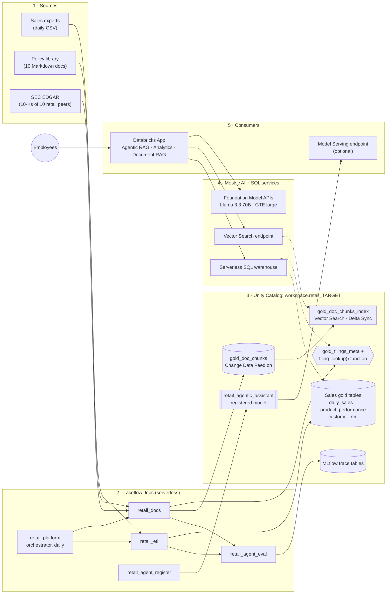
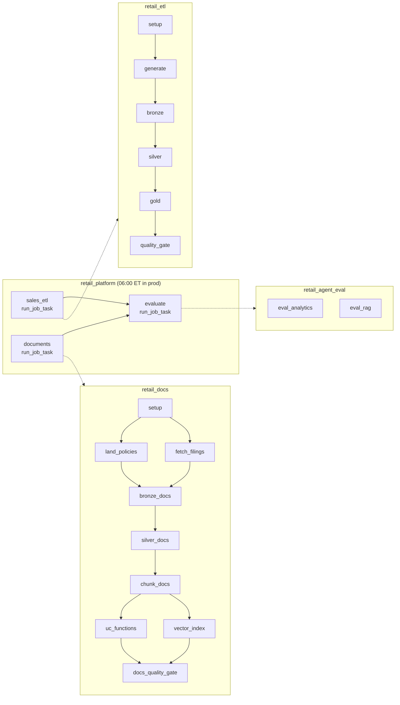
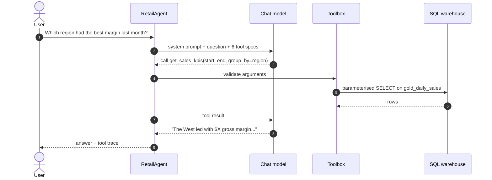
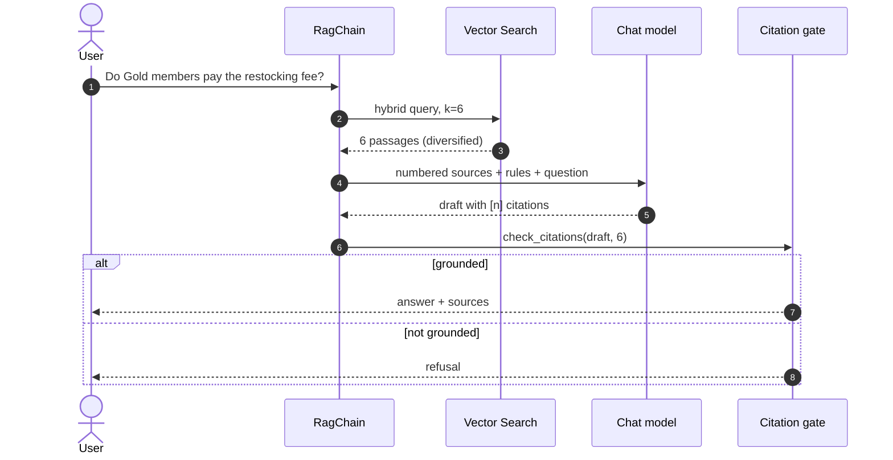
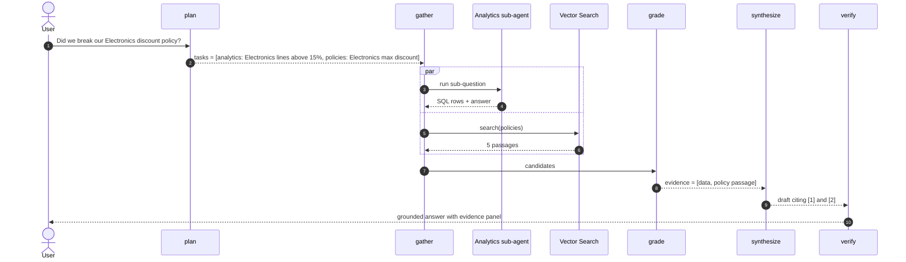
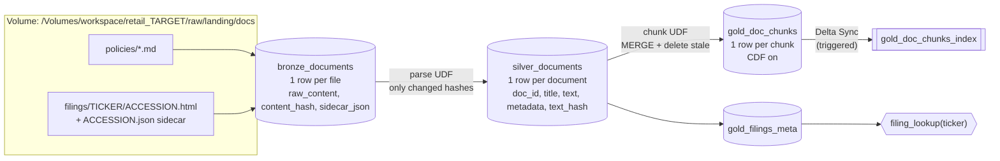
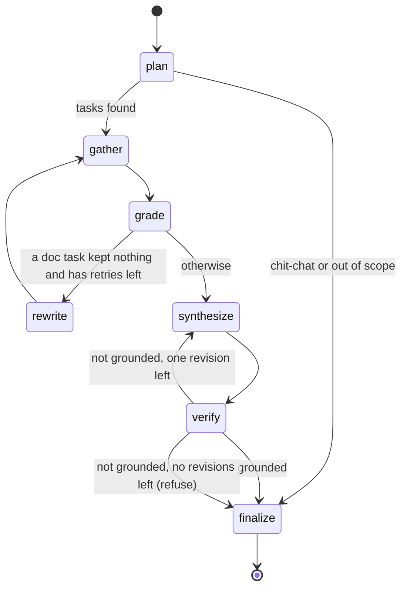
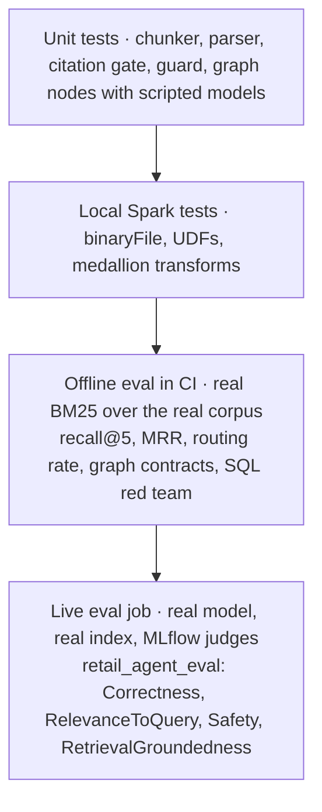
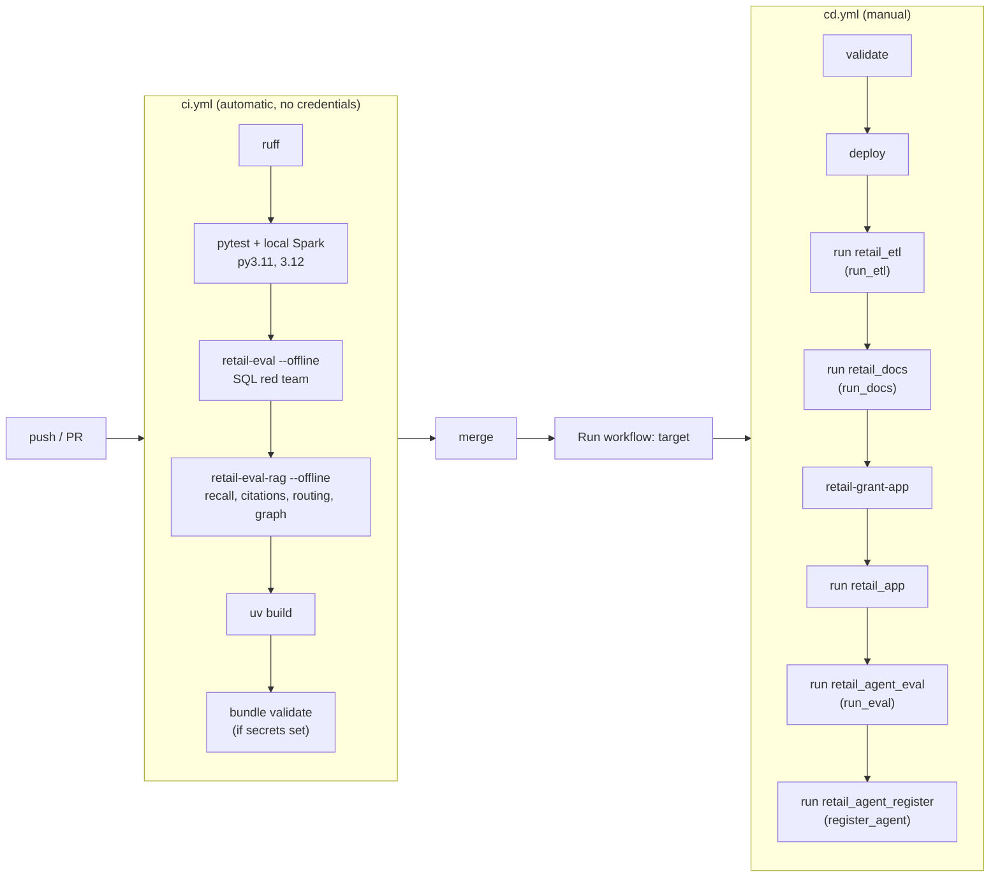

# Retail AI Platform on Databricks: the deep dive

This document walks the whole project from the top down. It starts at 50,000 feet, with what the thing is for and the one picture you need, and descends layer by layer until it reaches individual functions, table columns and YAML keys. Read the first two sections to understand the system. Read the rest when you need to change it.

Workspace: `https://dbc-d40d7b72-eeb2.cloud.databricks.com`

**What's new in this version.** Version 1 was a sales ETL plus a SQL agent. This version merges in the PolicyPilot project (RAG over SEC 10-K filings with a citation gate) and rebuilds it entirely on Databricks. Azure Key Vault, Entra ID OIDC, Groq behind Unity Gateway, Chroma and sentence-transformers are all gone. On top of that it adds a document pipeline, a Vector Search index, a classic RAG chain, an agentic RAG graph that combines SQL with documents, MLflow tracing and judge-based evaluation, and an optional Model Serving deployment.

---

## Contents

- [50,000 ft: what this is and why](#50000-ft-what-this-is-and-why)
- [30,000 ft: the platform on one page](#30000-ft-the-platform-on-one-page)
- [20,000 ft: how work moves through it](#20000-ft-how-work-moves-through-it)
- [10,000 ft: each layer in depth](#10000-ft-each-layer-in-depth)
  - [Structured ETL](#1-structured-etl)
  - [The document pipeline](#2-the-document-pipeline)
  - [Retrieval](#3-retrieval)
  - [The analytics agent](#4-the-analytics-agent)
  - [Classic RAG](#5-classic-rag)
  - [Agentic RAG](#6-agentic-rag)
  - [Observability](#7-observability)
  - [Evaluation](#8-evaluation)
  - [Serving](#9-serving)
  - [Security and governance](#10-security-and-governance)
- [1,000 ft: running it](#1000-ft-running-it)
- [Ground level: changing it](#ground-level-changing-it)
- [Appendix A: from Azure + Databricks to Databricks only](#appendix-a-from-azure--databricks-to-databricks-only)
- [Appendix B: glossary](#appendix-b-glossary)

---

## 50,000 ft: what this is and why

Cedarline Markets is a made-up US retail chain with nine stores in four regions, selling groceries, electronics, home goods, apparel and beauty products in stores and online. People there ask three kinds of questions.

1. **Numbers.** "What was net revenue in the West last week?" The answer lives in sales tables.
2. **Rules.** "How long do customers have to return a TV?" The answer lives in policy documents.
3. **Both, plus the outside world.** "Did we discount Electronics beyond what our pricing policy allows, and how does Best Buy describe its returns?" Answering that means running a query, reading a policy, reading a competitor's 10-K, and putting the three together without mixing them up.

Each kind of question needs a different technique, and this project builds all of them on one platform:

| Capability | What it does | Where it lives |
|---|---|---|
| **ETL** | Turns raw sales files and raw documents into clean, governed tables | `etl/`, `knowledge/` |
| **Simple agent** | A tool-calling loop that answers number questions with guarded SQL | `agent/` |
| **RAG** | Retrieve passages once, answer with citations, refuse if it can't cite | `rag/` |
| **Agentic RAG** | Plans, routes to SQL, policies or filings, judges what came back, retries, verifies citations | `agentic/` |

The design rests on a simple claim: **most of an AI assistant's quality is decided before the model runs.** Clean gold tables with good column comments, well-chunked documents with useful metadata, and a retrieval index that respects filters do more for answer accuracy than any prompt. That's why half of this repository is data engineering.

Everything runs on Databricks: serverless jobs, Unity Catalog, Vector Search, Foundation Model APIs, MLflow, Model Serving and Databricks Apps. No other cloud service is involved.

---

## 30,000 ft: the platform on one page



Read it left to right.

**Sources (1).** Sales arrive as daily CSV files. Policies are Markdown written by people. Competitor filings come from SEC EDGAR as inline-XBRL HTML.

**Jobs and Unity Catalog (2, 3).** Two pipelines turn sources into governed tables. The sales pipeline ends in three gold tables. The document pipeline ends in a chunk table with Change Data Feed switched on, which a Vector Search index keeps itself in sync with, plus a filings registry exposed through a SQL function. Every one of these objects is a Unity Catalog securable, so one permission model covers tables, index, function, model and traces.

**Services and consumers (4, 5).** The Databricks App holds all three assistants. They use a SQL warehouse for structured data, the Vector Search index for documents and a Foundation Model API endpoint for language. The evaluation job runs the same assistants against golden questions and logs to MLflow. The register job packages the agentic assistant for Model Serving.

### Which Databricks product does what

| Need | Databricks feature | Used for |
|---|---|---|
| Governance | Unity Catalog | Every table, the volume, the index, the function, the model, the trace tables |
| File landing | UC Volumes | Raw CSVs, policy Markdown, filing HTML, stream checkpoints |
| Batch + incremental compute | Serverless jobs, Auto Loader, Delta Lake | Both pipelines; `MERGE`, Change Data Feed |
| Orchestration | Lakeflow Jobs: task DAGs, `run_job_task`, schedules | The orchestrator, fan-out/fan-in in the docs job |
| SQL for agents | Serverless SQL warehouse + Statement Execution API | Analytics tools, `filing_lookup()`, grants |
| Semantic search | Mosaic AI Vector Search (Delta Sync, managed embeddings, hybrid queries) | Document retrieval |
| Language models | Foundation Model APIs (pay per token) | Chat model, embedding model |
| Tracing + evaluation | MLflow 3 (Tracing, GenAI evaluation, judges) | Live evals, debugging |
| Packaging + serving | MLflow ResponsesAgent, UC model registry, Agent Framework `agents.deploy` | Optional serving endpoint with Review App |
| UI | Databricks Apps | The Streamlit assistant |
| Infrastructure as code | Databricks Asset Bundles | Everything above that can be declared |

---

## 20,000 ft: how work moves through it

### The daily refresh



The structured and unstructured pipelines don't depend on each other, so the orchestrator runs them at the same time and only evaluates once both have finished. Inside the docs job the two sources (policies and filings) also land in parallel and fan in at bronze. Fan-out where work is independent and fan-in where it meets is the main reason to use a task DAG instead of one long script: a slow SEC download doesn't hold up the policies, and a failure in `vector_index` can be repaired and re-run from that task without re-downloading anything.

Each quality gate is a hard stop. If the sales gate fails, the evaluation never runs on bad numbers. If the docs gate fails (missing policies, empty chunks, or the smoke retrieval queries not finding the right document), the same applies.

### A question, three ways

The app has a mode switch, and each mode is a different execution path.

**Analytics agent.** A loop of model calls and SQL tool calls.



**Document RAG.** One retrieval, one generation, one deterministic check.



**Agentic RAG.** A state machine that decides what to do.



The `par` block shows the logical split. In the code, `gather` runs tasks one after another in a single node, which keeps traces easy to read. Making them concurrent is a small change if latency matters.

---

## 10,000 ft: each layer in depth

### 1. Structured ETL

This part is unchanged from v1 and documented in detail in [docs/v1-etl-and-analytics-agent.md](docs/v1-etl-and-analytics-agent.md). In short:

- **generate** lands deterministic synthetic CSVs (about 1.4% deliberately dirty rows) in the volume.
- **bronze** ingests them with Auto Loader using `availableNow`, keeping every column as a string and recording `_ingested_at` and `_source_file`.
- **silver** types with `try_cast` (serverless runs with ANSI mode on), deduplicates on `(order_id, line_no)`, applies eight named quality rules, sends failures to `quarantine_sales` with the list of rules they failed, and upserts the rest with `MERGE`.
- **gold** builds `gold_daily_sales`, `gold_product_performance` and `gold_customer_rfm`, and writes table and column comments that the agents later read.
- **quality_gate** checks the quarantine rate and reconciles gold revenue against silver, then logs a row to `ops_pipeline_runs`.

The new piece that touches the ETL is the policy library. Its numbers were written to line up with the generator: the pricing playbook caps Electronics discounts at 15%, while the generator hands out 10%, 15% and 20% promotions in every category. So some Electronics lines in the data really do break the policy, and the cross-source questions have real answers. `tests/test_knowledge.py::test_policies_agree_with_the_sales_data` keeps those facts from drifting apart.

### 2. The document pipeline

Documents get the same medallion treatment as sales. The shapes change: rows are whole files, and the gold grain is a chunk.



#### Landing

`land_policies` copies the ten Markdown files that ship inside the wheel into the volume, the same way another team's export would land there. `fetch_filings` downloads the latest 10-K for each ticker in `filing_tickers` (Walmart, Costco, Target, Home Depot, Lowe's, Amazon, Kroger, Best Buy, Dollar General, TJX) and writes a JSON sidecar next to each HTML file with company, form, filing date, accession number and URL.

Two details are worth knowing before you run it.

- **SEC requires a contact in the User-Agent.** Set the bundle variable `sec_user_agent` to something like `Cedarline Data ops@yourdomain.com`. If it's empty, the task logs a warning and skips filings, and the rest of the pipeline builds a policy-only knowledge base. That's deliberate: a missing optional source shouldn't break the core.
- **Serverless needs outbound access to sec.gov.** Some workspaces restrict egress. If the downloads fail, you get the same graceful degradation. Set `--require-filings true` if you'd rather the task fail.

Filings already on disk are skipped, so re-runs don't hammer EDGAR.

#### Bronze: files as rows

```python
spark.read.format("binaryFile")
     .option("recursiveFileLookup", "true")
     .option("pathGlobFilter", "*.{md,html}")
     .load(landing_docs)
```

The `binaryFile` reader returns one row per file with its path, size, modification time and bytes. Bronze decodes the bytes, computes a SHA-256 `content_hash`, joins each filing to its sidecar by file stem, and upserts by path, updating a row only when the hash changed. Bronze stays raw: no parsing, nothing dropped.

#### Silver: parsing

Parsing runs in a Python UDF that calls `knowledge/documents.py`. That module uses only the standard library, so the same code runs on a laptop, in a test and inside Spark executors.

- **Policies** carry a small front-matter block (`doc_id`, `title`, `owner`, `effective_date`, `version`) that becomes metadata. The body is already clean Markdown.
- **Filings** are inline-XBRL HTML: large, and full of things that aren't prose. `html_to_text` drops scripts and styles, skips the hidden `<ix:header>` block (thousands of XBRL facts nobody wants to embed) and anything styled `display:none`, puts line breaks at block elements, renders table cells with separators, and filters out stray page numbers.

Silver only parses documents whose bronze `content_hash` differs from the one it last parsed. A parse failure in one file is recorded and logged rather than failing the batch.

The UDFs are declared with `useArrow=False`. Recent Spark versions can run Python UDFs through Arrow by default, and on some Spark and pandas combinations that path hangs (it did in this project's local test environment). Pickled UDFs behave the same everywhere, and with a few dozen large rows Arrow wouldn't speed anything up.

#### Gold: chunking

This is where the design improves most on PolicyPilot, which cut every filing into fixed 1,200-word windows with 200 words of overlap. Fixed windows are easy to build, but a window often starts in the middle of one topic and ends in the middle of another. That blurs the embedding and makes citations vague. `knowledge/chunking.py` does three things instead.

1. **Split by the document's own structure.** Policies split at Markdown headings and keep the heading path, for example `Returns and Refunds Policy > Category exceptions > Electronics`. Filings split at `Item 1.`, `Item 1A.`, `Item 7.` and so on. A 10-K lists every Item twice, once in the table of contents and once for real, so any "section" shorter than 120 words between two Item headings is treated as a TOC entry and dropped. So is any `Item 4. Not applicable`.
2. **Pack paragraphs, don't slice words.** Within a section, paragraphs are packed greedily up to about 220 words (hard maximum 320), with 40 words of overlap carried into the next chunk. A chunk never crosses a section boundary. Tiny sections are folded into their neighbour, so nothing gets indexed as a 9-word chunk.
3. **Add a contextual header for retrieval only.** Each chunk has two text columns. `content` is what the model reads and cites. `embed_text` is `"{title} | {section path}\n{content}"`, and that's what gets embedded. A passage that just says "15-day return window for every customer" now also carries "Returns and Refunds Policy > Category exceptions > Electronics", so a search for "electronics returns" finds it even though the passage never says "electronics" twice.

Chunk ids are deterministic (`{doc_id}::{index:04d}`), so re-chunking an unchanged document produces identical rows.

#### Keeping the index honest: MERGE, deletes and Change Data Feed

When a document changes, its chunks can change in number. If the new version has 7 chunks and the old one had 9, chunks 8 and 9 must disappear from the index, or retrieval will keep serving text that no longer exists. `chunk_docs` handles that in one statement:

```sql
MERGE INTO gold_doc_chunks t USING _new_chunks s ON t.chunk_id = s.chunk_id
WHEN MATCHED THEN UPDATE SET *
WHEN NOT MATCHED THEN INSERT *
WHEN NOT MATCHED BY SOURCE AND t.doc_id IN (<changed docs>) THEN DELETE
```

The table is created with `delta.enableChangeDataFeed = true`. A Delta Sync index reads that feed, so inserts, updates and deletes all reach the index on the next sync. Only changed documents are re-chunked, which is what "changed" means here: the `text_hash` in silver differs from the `doc_text_hash` stored on the chunks.

#### Vector Search

Vector Search has two objects, and people often confuse them.

- An **endpoint** is compute. It hosts indexes and answers queries. One is enough for a workspace; this project calls it `retail-ai-vs` and shares it across targets.
- An **index** is data. It belongs to a schema in Unity Catalog (`workspace.retail_dev.gold_doc_chunks_index`) and is governed like a table.

The index here is a **Delta Sync index with Databricks-managed embeddings**. You point it at the chunk table, name the column to embed (`embed_text`) and the embedding endpoint (`databricks-gte-large-en`), and Databricks computes embeddings for new and changed rows during sync. The same model embeds query text at search time. This removes a whole class of bugs PolicyPilot had to guard against, where query vectors and document vectors came from different models or versions.

The pipeline type is **TRIGGERED**: the index syncs when the job asks it to, which suits a daily batch and costs less than **CONTINUOUS**.

The `vector_index` task creates the endpoint and index if they're missing, syncs otherwise, and then waits until the index reports ready with as many rows as the table. Why a job task and not bundle resources? Recent CLI versions can declare `vector_search_endpoints` and `vector_search_indexes` in a bundle, but a Delta Sync index can only be created once its source table exists, and on a fresh workspace that table doesn't exist until the first pipeline run. Creating the index inside the pipeline keeps `bundle deploy` working on an empty schema.

#### The UC function

`gold_filings_meta` holds one row per filing. `uc_functions` registers a SQL table function over it:

```sql
CREATE OR REPLACE FUNCTION workspace.retail_dev.filing_lookup(p_ticker STRING)
RETURNS TABLE (ticker STRING, company STRING, form STRING, filing_date DATE,
               accession_number STRING, url STRING)
RETURN SELECT ... FROM gold_filings_meta
       WHERE coalesce(p_ticker, '') = '' OR upper(ticker) = upper(p_ticker)
```

PolicyPilot answered "when was Apple's 10-K filed?" from a local `manifest.json`. A UC function is the governed equivalent: it has an owner, a comment and lineage, it's callable from SQL, from notebooks and from agents, and `EXECUTE` on it is granted like any other privilege. Facts like dates belong in structured lookups, not in semantic search. A vector index is good at "what does the filing say about returns" and bad at "what's the exact filing date".

#### The docs quality gate

The last task fails the run if any of these is false:

- chunks exist, and chunk ids are unique
- no chunk is empty, and no chunk exceeds 400 words
- all ten policies are indexed
- three smoke queries (electronics return window, Grocery discount cap, At Risk playbook) each find the expected document in the top 3 results from the real index

The last check is the useful one. It catches a broken embedding endpoint, a stale index or a chunking regression, which are exactly the failures a row count can't see. Results go to `ops_docs_runs`.

### 3. Retrieval

All retrievers implement one protocol:

```python
search(query, k=5, source=None, ticker=None) -> list[Passage]
```

#### Dense, sparse and hybrid

There are two families of retrieval, and they fail in opposite ways.

- **Dense (embedding) retrieval** maps text to vectors so that similar meanings land close together. It handles paraphrase well: "send it back" finds "returns". It struggles with exact tokens like SKU codes, "OTIF" or a specific percentage.
- **Sparse (keyword) retrieval**, BM25 being the classic, scores documents by the query terms they contain, weighted by how rare each term is. It nails exact tokens and misses paraphrase.

**Hybrid retrieval** runs both and merges the rankings. `VectorSearchRetriever` sends `query_type="HYBRID"`, so Vector Search combines its embedding search with keyword matching on the server. For a corpus full of policy terms, percentages and ticker symbols, hybrid is the right default.

#### BM25, and why it's in the repo

`BM25Retriever` is a small, pure-Python BM25. For each query term `t` in document `d`:

```
score += idf(t) * tf(t,d) * (k1 + 1) / (tf(t,d) + k1 * (1 - b + b * |d| / avgdl))
idf(t) = ln(1 + (N - df(t) + 0.5) / (df(t) + 0.5))
```

with `k1 = 1.4` and `b = 0.75`. Term frequency saturates, so repeating a word ten times doesn't make a passage ten times better, and long passages are penalised in proportion to their length. Tokenisation lowercases, drops stopwords and does light suffix stripping.

It exists for two reasons. Local development needs retrieval without a workspace (`RETAIL_RETRIEVER=local`). And CI needs a retriever whose metrics mean something. Running it over the real policy library against hand-labelled expected documents gives a real recall@5 on every pull request (100% at the time of writing, MRR 0.97). A chunking change that breaks retrieval fails CI before anything reaches the workspace.

#### Filters, and the ticker lesson

PolicyPilot found this bug in production: once the corpus grew past a handful of companies, a question about Apple pulled chunks from other companies' filings, because the resolved ticker never reached the search call. Here the agentic planner resolves company names to tickers ("Best Buy" becomes `BBY`), only accepts tickers in the known list, and passes them as a metadata filter (`filters_json={"source": "filing", "ticker": "BBY"}`). `tests/test_agentic.py::test_filing_tasks_are_scoped_to_the_resolved_ticker` and `tests/test_rag.py::test_bm25_ranks_and_filters` keep that fixed. Source filters do the same job for policies versus filings, so a question about our own return policy can't be answered from Walmart's 10-K.

#### Diversification

Long documents produce many similar chunks. Without a cap, a question about returns can fill all five slots with adjacent chunks of one filing. `diversify()` keeps the ranking order but allows at most two passages per document. The Vector Search retriever over-fetches 3× before diversifying, so it still returns `k` passages.

### 4. The analytics agent

Unchanged from v1 apart from now also running as a sub-agent. It's a plain tool-calling loop (no framework, about 60 lines) with six tools. Three are curated, with human-written SQL: `get_sales_kpis`, `top_products`, `customer_segments`. Three are exploratory: `list_tables`, `describe_table`, and `run_sql`, which goes through a sqlglot-based guard. The guard allows a single SELECT over allowed tables, rejects DML, DDL and risky functions, and enforces a row limit. Tools never raise: errors go back to the model as data so it can correct itself. A hard limit of six steps bounds cost. Details are in the v1 document.

### 5. Classic RAG

`rag/chain.py` is the baseline, and for plain document questions it's often all you need.

```
retrieve(k=6) -> format numbered sources -> generate -> check_citations -> answer or refuse
```

The prompt sets a contract. Use only the numbered sources. End every factual sentence with `[n]`. Say so if the sources don't answer the question. Never present another retailer's practice as Cedarline's. Each source is labelled `Cedarline policy: ...` or `SEC filing: ...`, so the model can see which is which.

#### The citation gate

PolicyPilot's verify step rejected any answer without at least one `[n]`. That blocks the worst failure, an uncited answer from general knowledge, but it lets two others through: citations to sources that don't exist (`[7]` when there are five), and answers where one sentence is cited and four aren't. `rag/citations.py` checks three things:

| Check | Rule |
|---|---|
| Validity | every `[n]` must be between 1 and the number of sources |
| Presence | at least one valid citation |
| Coverage | at least 50% of factual sentences carry a valid citation |

"Factual sentence" is a heuristic: four or more words, not a heading, and not an "I couldn't find..." style disclaimer. A draft that fails any check becomes a fixed refusal. The draft is kept on the result for debugging and evaluation.

This gate is deterministic, so it's fast, free and easy to test. It can't tell whether a cited source actually supports the sentence. That's the job of the RetrievalGroundedness judge in the live evaluation (section 8).

### 6. Agentic RAG

Classic RAG makes one decision: which passages are nearest to the question. Agentic RAG makes several, and each fixes a specific way the chain fails.

| Chain failure | Agentic fix | Node |
|---|---|---|
| The question needs numbers, but RAG only reads documents | Route number questions to the SQL agent | `plan`, `gather` |
| A compound question gets one blended search that serves neither half | Split it into focused tasks, each with its own source | `plan` |
| Retrieval returns near misses, and the model answers from them anyway | Grade every passage and drop irrelevant ones | `grade` |
| The user's wording doesn't match the document's wording | Rewrite the query and try once more | `rewrite` |
| The draft cites badly | Give feedback and allow one revision, then refuse | `verify`, `synthesize` |

#### The state machine



It's built with LangGraph's `StateGraph` because the control flow is a real graph with two loops. That's also the framework PolicyPilot used, so its plan → retrieve → answer → verify structure carries over and grows. Each node is a method on `AgenticRAG`, so it can be read and unit-tested on its own.

#### State

```python
class AgenticState(TypedDict, total=False):
    question: str
    history: list[dict]
    tasks: list[Task]  # Task(route, query, ticker, attempts)
    pending: list[Task]  # what gather should run next
    reply: str  # direct reply when there are no tasks
    candidates: list[tuple[Task, list[Passage]]]
    evidence: list[Evidence]  # what synthesize may cite, numbered 1..n
    retry: list[Task]
    draft: str
    report: CitationReport
    revisions: int
    final: str
    grounded: bool
    steps: Annotated[list[dict], operator.add]  # append-only trace for the UI
```

`steps` uses a reducer (`operator.add`), so every node appends to the trace rather than overwriting it. Everything else is replaced by the node that returns it.

#### The nodes

**plan.** One model call with a prompt that describes the four routes:

| Route | Source | Example task |
|---|---|---|
| `analytics` | Sales tables, through the analytics agent | "Electronics order lines with discount above 15% in the last 30 days" |
| `policies` | Vector Search, `source = policy` | "maximum promotional discount Electronics" |
| `filings` | Vector Search, `source = filing`, optional `ticker` | "Best Buy product returns" |
| `filing_meta` | `filing_lookup()` UC function | "Walmart latest 10-K date" |

The model returns JSON with one to four tasks. Routes outside the list are dropped, and tickers are validated against the known peers. If the output can't be parsed, a keyword router takes over (`heuristic_plan`): words like revenue, margin or "how many" mean analytics; policy, maximum, refund or warranty mean policies; a company name means filings, or filing_meta when the question asks when something was filed. Questions outside the domain get a short reply and no tool calls.

**gather.** Runs every pending task with its tool.

- *Analytics tasks are delegated to the analytics agent.* This is agent composition: the agentic graph doesn't need its own SQL logic, and every SQL guardrail from section 4 still applies. The sub-agent's answer, the rows behind it and the SQL it ran become one `Evidence(kind="data")` item.
- *Policies and filings tasks* call the retriever with the right source and ticker filters and keep the hits as candidates.
- *filing_meta tasks* call `SELECT * FROM <catalog>.<schema>.filing_lookup('WMT')` through the warehouse.

**grade.** For each retrieval task, one model call shows the candidate passages and asks which numbers are relevant. Only those become evidence. This is the core idea of corrective RAG: retrieval is noisy, so check before you trust it. If the grader's output can't be parsed, the top three hits are kept, so a flaky grader degrades to classic RAG instead of returning nothing.

**rewrite.** A retrieval task that kept nothing gets one rewrite: the model is asked for a query in the vocabulary a policy or a 10-K would use. The new query goes back through `gather` and `grade`. One retry per task, then the graph moves on with whatever evidence it has.

**synthesize.** Numbers every evidence item (`[1] Sales data: ...`, `[2] Cedarline policy: ...`, `[3] SEC filing: Best Buy 10-K (filed ...) > Item 1A ...`) and asks for an answer that cites them. The prompt is explicit about data-plus-policy questions: state the number, state the rule, then the conclusion, each cited. On a revision, the previous draft and a specific complaint ("citations [7] do not exist", "only 1 of 3 factual sentences cited") are added to the conversation.

**verify.** Runs the citation gate from section 5 against the evidence count.

**finalize.** Returns the draft if it's grounded, the direct reply if there were no tasks, or the refusal otherwise.

#### Cost and latency are bounded

Every loop has a cap, so the worst case is known in advance. With `T` tasks (at most 4), each retrieval task costs one grader call per attempt (at most 2 attempts) plus at most one rewrite, each analytics task runs a sub-agent with at most 6 model calls, and synthesis runs at most twice:

```
worst case model calls = 1 (plan) + Σ tasks [analytics: 6 | retrieval: 2 grades + 1 rewrite] + 2 (synthesize)
typical cross-source question = 1 + 2 (sub-agent) + 1 (grade) + 1 (synthesize) = 5 calls
```

LangGraph's `recursion_limit` of 25 is a final safety net on top of these caps.

#### Which mode to use

| Question | Best mode | Why |
|---|---|---|
| "Net revenue by region last week" | Analytics agent | Pure numbers; fewer model calls |
| "What's the Grocery discount cap?" | Document RAG | One document question; one retrieval is enough |
| "Did we break the discount policy?" | Agentic RAG | Needs SQL and a policy, then a comparison |
| "What does Target say about supply chain risk?" | Document RAG or Agentic RAG | Agentic resolves the ticker and filters; RAG relies on the search finding Target's filing by keywords |
| "When did Walmart file its 10-K?" | Agentic RAG | Structured fact; goes to the UC function, not the index |

The app defaults to Agentic RAG because it handles every row of that table. The other two modes stay available because they're cheaper and easier to reason about when you know the question's shape.

### 7. Observability

Every step that matters is wrapped in `obs.tracing.span(name, type, inputs)`:

```
agentic_rag (AGENT)
├── agentic.plan (AGENT)
├── agentic.analytics (AGENT)       → the sub-agent's own tool calls
├── agentic.retrieve (RETRIEVER)    → passages as mlflow Documents
├── agentic.grade (LLM)
├── agentic.rewrite (LLM)
├── agentic.synthesize (LLM)
└── agentic.filing_lookup (TOOL)
```

When tracing is off (the default in tests and on laptops) `span` is a no-op, and the core code doesn't import MLflow at all. When it's on (`RETAIL_TRACING=on`, or `setup_tracing()` in the eval and serving jobs) each span becomes an MLflow span. Retriever spans record the passages as `mlflow.entities.Document` objects with chunk id, document id, section and score, because that's the shape the retrieval judges read.

On Databricks, `setup_tracing()` binds the experiment to a **Unity Catalog trace location** in the project schema, so traces land in Delta tables you can query with SQL and govern with grants, rather than in workspace experiment storage. It needs MLflow 3.11 or newer and a SQL warehouse; the eval job passes the bundle's warehouse.

The app also keeps a plain JSON trace of graph steps (`result.steps`) and shows it in a **Trace** expander under each answer. It covers which route was chosen, what was retrieved, what was kept, whether a rewrite happened and why verify passed or failed. That's usually enough to debug a bad answer without opening MLflow.

### 8. Evaluation

Testing an AI system means testing at several levels, from fast and narrow to slow and broad.



Levels 1 to 3 run on every pull request, with no credentials and no token spend. Level 4 runs in the workspace after each platform refresh.

#### Golden data

`evals/rag_golden.json` holds 23 questions:

- **16 policy questions**, each with the expected document ids and expected facts ("15 days", "Gold members are exempt from the 10% restocking fee").
- **6 cross-source questions** with the routes they should take (`["analytics", "policies"]`, `["filing_meta"]` and so on). Three of them need filings and are skipped when no filings are indexed.
- **1 off-topic question** that should be declined.

`evals/golden_questions.json` (from v1) holds the analytics questions, whose expected values are computed by reference SQL at eval time, so they never go stale.

#### Metrics

| Metric | Definition | Offline gate | Live gate |
|---|---|---|---|
| recall@5 | share of questions with an expected document in the top 5 | ≥ 0.9 (BM25) | ≥ 0.8 (Vector Search) |
| MRR | mean of 1 / rank of the first expected document | reported | reported |
| citation contract | grounded drafts pass, uncited or invalid ones are refused | must hold | n/a |
| routing rate | expected routes ⊆ routes taken | ≥ 0.8 (keyword router) | ≥ 0.7 (model planner) |
| graph contract | every cross-source question ends grounded on the right routes with a scripted model | must hold | n/a |
| grounded rate | grounded answers (or correct refusals) / questions | n/a | ≥ 0.8 |
| Correctness | judge: the answer contains the expected facts | n/a | reported |
| RetrievalGroundedness | judge: the answer is supported by the retrieved passages | n/a | reported |
| RelevanceToQuery, Safety | judges | n/a | reported |

The judges come from `mlflow.genai.scorers` and run as Databricks-hosted judge models. Results and per-question traces land in the experiment `/Shared/retail-ai-platform/evals-<target>`. The job fails on the deterministic thresholds. Judge scores are reported rather than gated, because judge models drift a little between versions. Once you have a few runs of history, gate on them too.

#### Why recall is measured separately

When a RAG answer is wrong, the first question is whether the right passage was retrieved at all. If it wasn't, no prompt will fix it. Measuring retrieval on its own separates "the index can't find it" (fix chunking, metadata or the embedding model) from "the model misread it" (fix the prompt or the model).

### 9. Serving

The app is one way to use the agentic assistant. Model Serving is the other: an HTTPS endpoint other systems can call, with request logging, the Review App for stakeholder feedback, and scale to zero.

`serving/agent_model.py` wraps the graph in an **MLflow `ResponsesAgent`**, the interface Mosaic AI Agent Framework expects. It converts OpenAI Responses-style input to chat messages, runs the graph with the last six turns of history, and returns the answer plus `custom_outputs` (grounded flag, routes, sources with chunk ids and SQL).

`serving/register.py` (job `retail_agent_register`) does three things.

1. **Logs the model as code.** `mlflow.pyfunc.log_model(python_model="agent_model.py", code_paths=[retail_insights/], model_config={...})`. MLflow stores the source file and the package, and at load time runs the file, which calls `mlflow.models.set_model(AGENT)`. `model_config` carries catalog, schema, warehouse and endpoint, so one artifact can point at dev or prod.
2. **Declares resources.** The chat endpoint, the embedding endpoint, the Vector Search index, the SQL warehouse, the `filing_lookup` function and the tables the agent reads. Model Serving uses this list to issue short-lived credentials for exactly those resources (automatic authentication passthrough), so no tokens are baked into the model.
3. **Registers** it in Unity Catalog as `<catalog>.<schema>.retail_agentic_assistant`, after a smoke prediction on the reloaded artifact. With `deploy_agent=true` it then calls `databricks.agents.deploy(..., scale_to_zero=True)`.

App or endpoint? Use the app for people and the endpoint for systems. They run the same code.

### 10. Security and governance

| Identity | Can do | Granted by |
|---|---|---|
| You (dev target) | Deploy to your user folder, own `retail_dev` | Development mode |
| CI/CD service principal | Deploy bundles, run jobs, own staging and prod schemas | Workspace admin |
| Jobs | Run as the deployer | Bundle |
| App service principal | `CAN_USE` warehouse, `CAN_QUERY` chat and embedding endpoints; `USE CATALOG`, `USE SCHEMA`, `SELECT` and `EXECUTE` on its schema; `CAN_USE` on the Vector Search endpoint | `apps.yml` resources + `retail-grant-app` |
| Serving endpoint | Exactly the resources declared at log time | Automatic authentication passthrough |

A few points worth stating plainly.

- **The assistants can read but never write.** `SELECT` on the schema covers the tables and the Vector Search index (a UC securable). `EXECUTE` covers UC functions. Nothing grants `MODIFY`.
- **Guardrails are layered.** Curated tools with validated parameters, the SQL guard for model-written queries, a read-only identity enforced by Unity Catalog, source and ticker filters on retrieval, the citation gate, and step limits on every loop. Any one layer can fail without the system writing data or answering from thin air.
- **Personal data stays out.** `silver_customers` holds names and emails, so it's not on the agent's table allowlist. The guard rejects any query that touches it, and `describe_table` won't show it. Customer questions go through `gold_customer_rfm`, which carries only id, loyalty tier and home state. The data access policy (`POL-AI-010`) says the same thing in words, and the agent can retrieve and cite it. If you add sensitive columns to an allowed table, use Unity Catalog column masks rather than relying on prompts.
- **Everyone sees the same rows.** The app runs as its own service principal. If different people must see different data, turn on user authorization for the app so queries run as the signed-in user and UC row filters apply.

---

## 1,000 ft: running it

### Repository layout

```
retail-ai-platform/
├── databricks.yml                    # bundle: variables, artifact build, dev/staging/prod targets
├── resources/
│   ├── jobs.yml                      # retail_platform, retail_etl, retail_docs, retail_agent_eval, retail_agent_register
│   └── apps.yml                      # the app + warehouse/endpoint bindings
├── app.yaml                          # app start command and env
├── requirements.txt                  # what Databricks Apps installs
├── pyproject.toml                    # package, 18 console scripts, ruff, pytest
├── Makefile
├── .github/workflows/{ci,cd}.yml
├── scripts/demo_agentic_trace.py     # stream the graph node by node
├── docs/v1-etl-and-analytics-agent.md
├── src/retail_insights/
│   ├── config.py                     # every table / volume / index / function name
│   ├── etl/                          # sales medallion (v1)
│   ├── knowledge/
│   │   ├── corpus/policies/*.md      # the internal policy library (ships in the wheel)
│   │   ├── documents.py              # Markdown + inline-XBRL HTML parsing
│   │   ├── chunking.py               # structure-aware chunker
│   │   ├── edgar.py                  # SEC EDGAR client
│   │   ├── corpus.py                 # access to the bundled library
│   │   └── jobs.py                   # docs pipeline entry points
│   ├── rag/
│   │   ├── retrieval.py              # Passage, Retriever, BM25, VectorSearchRetriever
│   │   ├── citations.py              # citation gate
│   │   ├── chain.py                  # classic RAG
│   │   └── index_admin.py            # endpoint/index provisioning
│   ├── agentic/{graph,prompts}.py    # LangGraph agentic RAG
│   ├── agent/                        # analytics agent, SQL guard, LLM + warehouse clients, Runtime factory, fakes
│   ├── obs/tracing.py                # optional MLflow tracing
│   ├── evals/                        # golden sets, analytics + RAG runners
│   ├── serving/                      # ResponsesAgent + register/deploy
│   ├── ops/grants.py                 # app service principal grants
│   └── app/streamlit_app.py
└── tests/                            # 91 tests, including local Spark runs of the docs pipeline
```

### Quick start

```bash
# 1. local: no workspace needed
uv sync
make lint test eval              # ruff, pytest (Java needed for the Spark tests), both offline evals

# 2. authenticate
databricks auth login --host https://dbc-d40d7b72-eeb2.cloud.databricks.com

# 3. deploy and run dev
make validate deploy             # wheel, 5 jobs, app registration
databricks bundle run retail_platform -t dev \
    --var sec_user_agent="Your Name you@yourdomain.com"   # or set it in databricks.yml
make grant app                   # app SP grants, start the app

# 4. look around
make demo Q="Did we discount Electronics beyond our pricing policy?"
make register                    # optional: UC model (+ serving with --var deploy_agent=true)
```

The first `retail_platform` run takes longest because it creates the Vector Search endpoint, which can take several minutes. Later runs only sync the index.

Run the UI locally against your workspace:

```bash
export DATABRICKS_WAREHOUSE_ID=<id> RETAIL_SCHEMA=retail_dev
uv run streamlit run src/retail_insights/app/streamlit_app.py
# add RETAIL_RETRIEVER=local to use BM25 over the bundled policies instead of Vector Search
```

### Configuration

| Variable | Default | Notes |
|---|---|---|
| `catalog` | `workspace` | |
| `schema` | `retail_<target>` | set per target |
| `warehouse_id` | lookup "Serverless Starter Warehouse" | pass `--var warehouse_id=` on other workspaces |
| `llm_endpoint` | `databricks-meta-llama-3-3-70b-instruct` | any OpenAI-compatible chat endpoint good at tool calling |
| `embedding_endpoint` | `databricks-gte-large-en` | changing it means rebuilding the index |
| `vector_search_endpoint` | `retail-ai-vs` | shared across targets |
| `sec_user_agent` | empty (filings skipped) | `"Name email@domain"` |
| `filing_tickers` | 10 retail peers | comma separated |
| `etl_days` | 30 (3 in prod) | |
| `etl_schedule_status` | PAUSED (UNPAUSED in prod) | applies to `retail_platform` |
| `deploy_agent` | `"false"` | `"true"` makes the register job deploy to Model Serving |

App environment: `RETAIL_RETRIEVER` (`vector` or `local`), `RETAIL_SCHEMA` (derived from the app name if unset), `RETAIL_TRACING=on` to emit MLflow traces.

### CI/CD



Authentication is Databricks-native. Create a Databricks service principal, generate an OAuth secret for it, and store `DATABRICKS_CLIENT_ID` and `DATABRICKS_CLIENT_SECRET` as GitHub secrets. Better still, add a federation policy on the service principal that trusts GitHub's OIDC issuer for this repository, delete the secret, and set `DATABRICKS_AUTH_TYPE: github-oidc` in `cd.yml`; the workflow already requests `id-token: write`. Put the SEC contact in a repository variable `SEC_EDGAR_USER_AGENT`; CD passes it to the bundle as `BUNDLE_VAR_sec_user_agent`. Protect the `prod` environment with required reviewers.

CD runs only by manual dispatch (Actions → CD → Run workflow, or `gh workflow run cd.yml -f target=dev`). Each pipeline is a separate, switchable step: `run_etl` and `run_docs` default to on, while `run_eval` and `register_agent` default to off. The order is fixed on purpose. The document pipeline creates the Vector Search endpoint and index, so it has to finish before `retail-grant-app` can give the app `CAN_USE` on the endpoint, and before the app starts serving questions. Plan for the first `run_docs` on a new workspace to take around 20 minutes while the endpoint provisions. Later runs only sync changed chunks. In prod, the scheduled `retail_platform` job does the same refresh every day without going through GitHub.

`tests/test_bundle_config.py` also checks the workflows themselves. Every `bundle run X` has to be a job or app in the bundle, every `uv run retail-*` has to be a console script, the grant step has to target the app name the bundle creates, and the docs → grant → app order is enforced. A renamed job breaks CI, not a deploy.

The service principal needs workspace access, permission to create jobs and apps, `CAN_USE` on the warehouse, `USE CATALOG` and `CREATE SCHEMA` on the catalog, and permission to create Vector Search endpoints (or an existing endpoint it can use).

### Cost

| Component | Billing | Rough shape |
|---|---|---|
| ETL and docs jobs | Serverless jobs compute | Minutes per run on this data volume |
| Vector Search endpoint | Per hour while it exists | The biggest standing cost; delete it if you pause the project |
| Embeddings | Pay per token | Only changed chunks are embedded at sync |
| Chat model | Pay per token | About 5 calls per agentic question, 2 to 3 per analytics question, 1 per RAG question |
| SQL warehouse | Serverless, auto-stop | One to three small queries per analytics task |
| App | Per hour while running | Stop dev apps when idle |
| Serving endpoint (optional) | Per hour while scaled up | `scale_to_zero=True` |

On small or trial workspaces, quotas can limit you to one Vector Search endpoint, which is why the endpoint is shared across targets.

### Troubleshooting

| Symptom | Likely cause | Fix |
|---|---|---|
| `fetch_filings` logs "set --user-agent" | `sec_user_agent` empty | Set it; the pipeline still builds policies without it |
| `fetch_filings` connection errors | No egress to sec.gov from serverless | Allow egress, or run policy-only |
| `vector_index` times out on first run | Endpoint provisioning | Re-run the task; the endpoint keeps provisioning in the background |
| Quality gate: `smoke_retrieval_top3` false | Embedding endpoint unavailable, stale index, or a chunking regression | Check the index status in Catalog Explorer; run `retail-eval-rag --offline` locally |
| App answers "no grounded answer" for everything | Index empty, or app SP lacks `SELECT` on the index | `make docs grant` |
| App works in Analytics mode only | `RETAIL_RETRIEVER=vector` but no index yet | Run `retail_docs`, or set `RETAIL_RETRIEVER=local` temporarily |
| `PERMISSION_DENIED` on `filing_lookup` | Missing `EXECUTE` | `make grant` |
| Agentic answers route oddly | Planner prompt or model change | Read the Trace expander; run `make agent-eval` and compare route rate |
| Local Spark UDF tests hang | Arrow-UDF path on a mismatched pandas | Already handled with `useArrow=False`; make sure `PYSPARK_PYTHON` points at the venv |

---

## Ground level: changing it

**Add a document source.** Land files under `landing/docs/<source>/`, extend `documents.parse_file` for the format, and add a `source` value. Chunking, the index and retrieval filters pick it up without other changes. Add golden questions for it.

**Add a tool to the agentic graph.** Add a route name to `ROUTES` and the planner prompt, handle it in `gather`, and wrap the work in a `span`. Structured facts usually belong in a UC function, called through the warehouse like `filing_lookup`.

**Swap the chat model.** `--var llm_endpoint=<endpoint>`. Run `make agent-eval` before and after. The route rate and grounded rate tell you quickly whether the new model plans and cites as well.

**Swap the embedding model.** Change `embedding_endpoint`, delete the index, and re-run `retail_docs`. Mixed embedding models in one index are never safe.

**Make it continuous.** Switch the index pipeline type to `CONTINUOUS` and trigger `retail_docs` with a file-arrival trigger on the landing folder.

**Move the pipelines to Lakeflow Declarative Pipelines.** The quality rules map one-to-one onto expectations, bronze maps onto streaming tables, and gold onto materialized views. The pure functions in `transforms.py`, `documents.py` and `chunking.py` stay as they are.

**Parse PDFs.** Add a PDF branch to `parse_file`. For scanned documents, Databricks' `ai_parse_document` SQL function or a parsing library can produce the text; everything downstream stays the same.

**Expose the tools over MCP.** The toolbox and retrievers have plain Python signatures, so wrapping them in an MCP server lets other agents use the same guarded tools.

---

## Appendix A: from Azure + Databricks to Databricks only

| PolicyPilot (Azure + Databricks) | This project (Databricks only) | Why it's better here |
|---|---|---|
| Azure Databricks workspace (Central India) | Databricks workspace `dbc-d40d7b72-eeb2` | One platform, one bill |
| Azure Key Vault holding the Groq key, read in CD | No provider key at all | Foundation Model APIs authenticate with workspace identity |
| Entra ID app + federated credential + `azure/login` | Databricks service principal, OAuth M2M or GitHub OIDC federation | Fewer moving parts; no second identity system |
| Groq `gpt-oss-120b` behind a Unity Gateway provider service | Foundation Model API chat endpoint, configurable | No external provider to govern; swap by variable |
| Chroma (local) / self-managed embeddings with sentence-transformers | Vector Search with Databricks-managed `gte-large` embeddings; BM25 for local and CI | Query and document vectors can't drift apart; no model in the app container |
| `manifest.json` for filing metadata | `gold_filings_meta` + `filing_lookup()` UC function | Governed, queryable, grantable |
| Notebook `seed_chunks_table.py` run by hand | `retail_docs` job: incremental, idempotent, quality-gated | Repeatable; deletes stale chunks; tested |
| Fixed 1,200-word windows | Structure-aware chunks with contextual headers | Sharper retrieval and citations |
| Citation gate: "at least one [n]" | Validity + presence + coverage | Catches invented citations and half-cited answers |
| plan → retrieve → answer → verify | plan → gather → grade → rewrite → synthesize → verify, with SQL and UC-function tools | Answers data + document questions; corrects bad retrieval |
| Agent Evaluation with judges, needing Groq + Azure login in CI | Offline evals in CI with no credentials; judges in a Databricks job | Every PR gets a meaningful signal for free |
| LangGraph agent not packaged for serving | `ResponsesAgent` logged to UC, deployable with `agents.deploy` | Same agent in the app and behind an endpoint |

What carried over unchanged in spirit: the EDGAR client and its User-Agent rule, the ticker-scoping regression test, the refusal-over-guessing stance, the node-by-node demo script, and LangGraph as the graph runtime.

## Appendix B: glossary

- **Agentic RAG**: retrieval-augmented generation where a model decides which sources to query, judges the results and can retry, rather than following a fixed retrieve-then-generate chain.
- **Change Data Feed (CDF)**: a Delta Lake table feature that records row-level inserts, updates and deletes; Delta Sync indexes read it.
- **Contextual chunk header**: a title and section path prefixed to a chunk's text for embedding, so the chunk retrieves on context it doesn't repeat itself.
- **Corrective RAG**: grading retrieved passages and re-querying when they're irrelevant.
- **Delta Sync index**: a Vector Search index that keeps itself in sync with a Delta table.
- **Hybrid search**: combining embedding similarity with keyword matching in one query.
- **Managed embeddings**: Vector Search computes embeddings with a named serving endpoint, for both documents and queries.
- **Medallion architecture**: bronze (raw), silver (clean), gold (consumer-shaped) layers, each rebuildable from the one below.
- **MRR**: mean reciprocal rank, the average of 1 / rank of the first relevant result.
- **recall@k**: the share of questions where a relevant document appears in the top k results.
- **ResponsesAgent**: MLflow's interface for agents served on Databricks, using the OpenAI Responses request and response shapes.
- **UC function**: a SQL or Python function registered in Unity Catalog, governed and callable from SQL and agents.
