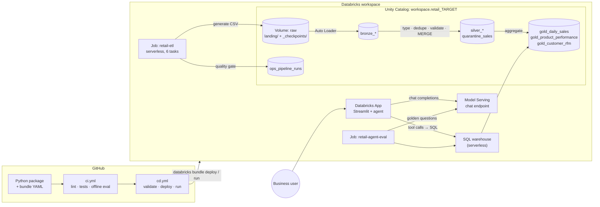
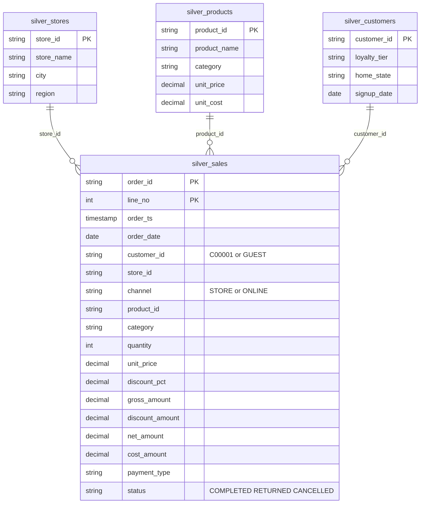
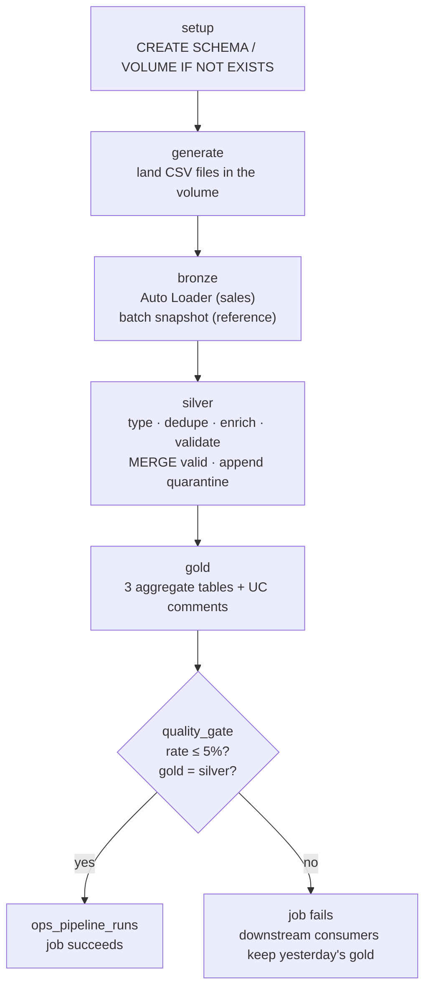
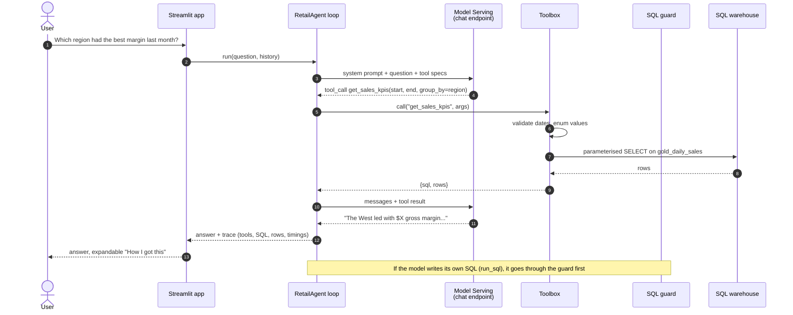
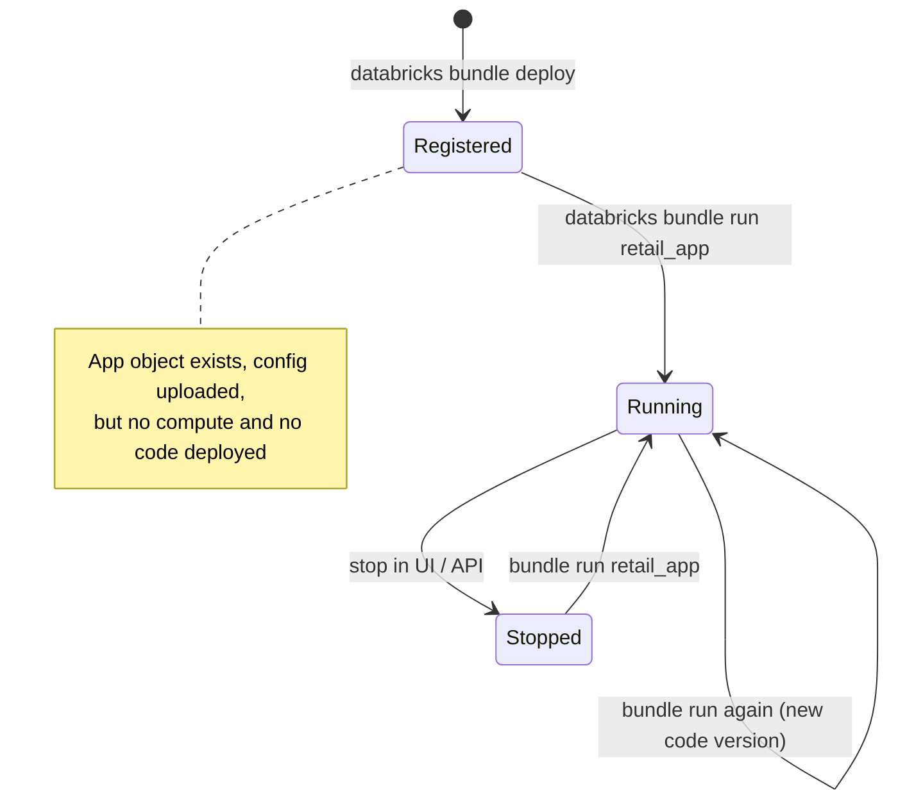
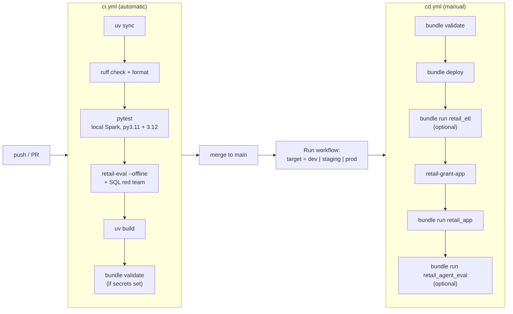

# v1 reference: ETL and the analytics agent

> This is the original write-up for the structured half of the platform: the sales medallion ETL and the SQL analytics agent. Everything here still applies. Names changed in v2: the bundle is `retail-ai-platform`, the app is `retail-ai-<target>`, and `make etl` now sits alongside `make docs` and `make platform`. For RAG, agentic RAG, the document pipeline, serving and the full architecture, read [README_UPDATE.md](../README_UPDATE.md).

A small but complete project that does two jobs most data teams end up owning together:

1. **Data engineering.** A medallion ETL (raw files → bronze → silver → gold) for a retail chain's sales, products, stores and customers, with incremental ingestion, data-quality rules, a quarantine table and a quality gate that fails the job when the data looks wrong.
2. **An AI agent on top of it.** A tool-calling analytics assistant that answers questions like *"which region had the best margin last month?"* by querying the gold tables through a SQL warehouse, served as a Streamlit app on Databricks Apps.

Everything is deployed with a **Databricks Asset Bundle** and shipped through **GitHub Actions**. The Python is a normal package built with `pyproject.toml` and `uv`, tested locally with a real SparkSession, so you can work on it without touching the workspace until you deploy.

Workspace: `https://dbc-d40d7b72-eeb2.cloud.databricks.com`

---

## Contents

- [The big picture](#the-big-picture)
- [Repository layout](#repository-layout)
- [Quick start](#quick-start)
- [Part 1: the data pipeline](#part-1-the-data-pipeline)
- [Part 2: the agent](#part-2-the-agent)
- [Part 3: evaluating the agent](#part-3-evaluating-the-agent)
- [Part 4: the Asset Bundle](#part-4-the-asset-bundle)
- [Part 5: CI/CD with GitHub Actions](#part-5-cicd-with-github-actions)
- [Security model](#security-model)
- [Cost](#cost)
- [Troubleshooting](#troubleshooting)
- [Where to take it next](#where-to-take-it-next)

---

## The big picture



Read it left to right. Code lives in GitHub. CI proves it works without any Databricks credentials. CD turns the bundle into real workspace objects: two jobs and an app. The ETL job fills Unity Catalog tables; the app's agent reads the gold tables through a SQL warehouse and talks to an LLM through Model Serving.

The two halves meet at the **gold layer**. That's deliberate. The agent never reads raw data, never sees half-cleaned rows, and leans on table and column comments that the ETL writes. Good data engineering is most of what makes an analytics agent accurate.

---

## Repository layout

```
retail-ai-platform/
├── databricks.yml                  # bundle root: name, variables, artifacts, targets
├── resources/
│   ├── jobs.yml                    # retail_etl + retail_agent_eval (serverless)
│   └── apps.yml                    # the Databricks App and its resource bindings
├── app.yaml                        # how the app container starts (command + env)
├── requirements.txt                # what Databricks Apps installs in the app container
├── pyproject.toml                  # package metadata, deps, console scripts, ruff, pytest
├── Makefile                        # shortcuts: make test, make deploy TARGET=dev ...
├── .github/workflows/
│   ├── ci.yml                      # every push / PR
│   └── cd.yml                      # manual deploy to dev / staging / prod
├── src/retail_insights/
│   ├── config.py                   # every table/volume name in one place
│   ├── etl/
│   │   ├── datagen.py              # deterministic synthetic retail data (+ dirty rows)
│   │   ├── schemas.py              # explicit raw schemas (all strings)
│   │   ├── transforms.py           # pure DataFrame logic for bronze/silver/gold
│   │   ├── quality.py              # named rules → valid / quarantine split
│   │   └── jobs.py                 # entry points: setup, generate, bronze, silver, gold, quality_gate
│   ├── agent/
│   │   ├── core.py                 # the tool-calling loop
│   │   ├── tools.py                # 6 tools: 3 curated, 3 exploratory
│   │   ├── sql_guard.py            # sqlglot-based guard for model-written SQL
│   │   ├── executor.py             # SQL warehouse via Statement Execution API
│   │   ├── llm.py                  # OpenAI-compatible client for Model Serving
│   │   ├── prompts.py              # system prompt
│   │   ├── factory.py              # build the agent from env vars
│   │   └── fakes.py                # fake warehouse + scripted LLM for tests and CI
│   ├── app/streamlit_app.py        # chat UI with a "how I got this" trace
│   ├── evals/
│   │   ├── golden_questions.json   # questions + reference SQL
│   │   └── runner.py               # offline and live eval, SQL red team
│   └── ops/grants.py               # give the app's service principal SELECT on the schema
└── tests/                          # 47 tests: datagen, Spark transforms, guard, agent, YAML wiring
```

### Which file is read by what

There are six YAML files and they are read by three different systems at three different times. Mixing them up is the most common source of confusion with bundles, so here it is in one table:

| File | Read by | When | What it decides |
|---|---|---|---|
| `.github/workflows/ci.yml` | GitHub Actions | every push / PR | lint, tests, offline agent eval, wheel build |
| `.github/workflows/cd.yml` | GitHub Actions | manual dispatch | validate, deploy, run ETL, grant, start app |
| `databricks.yml` | Databricks CLI | `bundle validate/deploy/run` | bundle name, variables, wheel build, targets |
| `resources/jobs.yml` | Databricks CLI | same | the two jobs, their tasks and serverless environment |
| `resources/apps.yml` | Databricks CLI | same | that the app exists, where its code is, what it may use |
| `app.yaml` | Databricks Apps runtime | app container start | the start command and environment variables |

`apps.yml` and `app.yaml` look similar and are not. The first registers the app as a workspace object. The second is read inside the running container. If you change the start command, you change `app.yaml`.

---

## Quick start

### What you need

- Python 3.11+ and [uv](https://docs.astral.sh/uv/)
- Java 17 or 21 (only for the local Spark tests)
- [Databricks CLI](https://docs.databricks.com/dev-tools/cli/install.html) v0.250 or newer
- Access to the workspace above, with Unity Catalog, serverless jobs and a SQL warehouse

### 1. Work locally, no workspace needed

```bash
uv sync                          # creates .venv with runtime + dev deps
make lint test eval              # ruff, 47 pytest tests, offline agent eval
```

`make test` spins up a local SparkSession with ANSI mode on (the same as Databricks serverless) and runs the real transformations against hand-built rows and against freshly generated CSV files.

### 2. Authenticate the CLI

```bash
databricks auth login --host https://dbc-d40d7b72-eeb2.cloud.databricks.com
databricks current-user me
```

### 3. Deploy and run in dev

```bash
make validate            # databricks bundle validate -t dev
make deploy              # builds the wheel, uploads it, creates jobs + app
make etl                 # runs setup → generate → bronze → silver → gold → quality_gate
make grant               # app service principal gets SELECT on retail_dev
make app                 # starts the app compute and deploys its code
```

`make app` prints the app URL. Open it, click one of the example questions and expand **How I got this** under the answer to see each tool call, the SQL that ran and the rows that came back.

Then try the live eval:

```bash
make agent-eval          # golden questions against the real model and real tables
```

### If your warehouse isn't called "Serverless Starter Warehouse"

`databricks.yml` looks up the warehouse by that name, which is the default on new and Free Edition workspaces. On other workspaces pass the ID:

```bash
databricks bundle deploy -t dev --var warehouse_id=1234567890abcdef
```

---

## Part 1: the data pipeline

### The medallion idea, briefly

The medallion architecture splits a pipeline into layers with a clear contract each:

- **Bronze** keeps what arrived, exactly as it arrived, plus where and when it came from. You never lose source data, so you can always rebuild everything downstream.
- **Silver** is clean, typed, deduplicated and validated. One row per real-world thing (here, one row per order line). This is the layer you'd join against.
- **Gold** is shaped for a specific consumer: dashboards, ML features, or, in this project, an agent. It holds business definitions ("net revenue means completed lines minus discounts") so every consumer gets the same number.

The value isn't the three names. It's that each layer can be rebuilt from the one below, and that bugs get caught at a known boundary instead of leaking into a CFO's dashboard.

### The data model



9 stores across 4 regions, 31 products in 5 categories (with realistic margins per category), 500 customers, and roughly 300 order lines a day with more on weekends. About 15% of orders are guest checkouts.

### Task by task



Each box is a `python_wheel_task` that calls a console script from the package (see `[project.scripts]` in `pyproject.toml`). Tasks are separate so a failure in `gold` can be repaired and re-run without re-ingesting.

#### `setup`

Creates the schema and the `raw` volume if they don't exist. Doing it inside the job (rather than as bundle-managed `schemas:` / `volumes:` resources) keeps the schema name exactly `retail_<target>`. Development mode prefixes bundle-managed resource names with your username, which would make the schema name differ between you and CI.

#### `generate`: the landing zone

`datagen.py` produces CSV files the way a POS export or SFTP drop would, one file per day in `/Volumes/workspace/retail_<target>/raw/landing/sales/`. Reference data (stores, products, customers) lands as full snapshots.

Two details matter:

- **Deterministic.** Sales for a given day are seeded by the date, so re-landing a day produces identical rows. Re-runs are safe.
- **Deliberately dirty.** About 1.5% of lines are broken in ways real feeds break: exact duplicates, blank customer IDs, negative quantities, unknown products, unparseable timestamps. Without bad data, the quality layer would be untested decoration.

#### `bronze`: Auto Loader and checkpoints

```python
spark.readStream.format("cloudFiles")
    .option("cloudFiles.format", "csv")
    .schema(RAW_SALES_SCHEMA)               # every column is STRING
    .option("rescuedDataColumn", "_rescued_data")
    ...
    .writeStream.option("checkpointLocation", ".../_checkpoints/bronze_sales")
    .trigger(availableNow=True)
    .toTable("bronze_sales")
```

Things worth understanding here:

- **Auto Loader (`cloudFiles`)** discovers new files in a directory and remembers which ones it has already processed. That memory lives in the **checkpoint**. Delete the checkpoint and it re-reads everything; keep it and each run picks up only new files.
- **`availableNow=True`** makes a streaming query behave like a batch job: process everything new, then stop. You get streaming's exactly-once bookkeeping with batch scheduling and batch cost.
- **All-string schema.** Bronze never rejects a row because a value is malformed. `"abc"` in a quantity column is preserved as-is; silver decides what to do with it. If bronze typed the data, one bad file could fail ingestion and you'd lose the evidence.
- **`_rescued_data`** captures anything that doesn't fit the schema (an extra column, a type surprise) instead of dropping it.
- **Metadata columns.** `_ingested_at` and `_source_file` (from Spark's `_metadata.file_path`) let you trace any gold number back to the file it came from.

Reference tables are small, full snapshots, so they're read in batch and overwritten. Not everything needs to be a stream.

#### `silver`: typing, dedupe, validation, MERGE

The silver task does five things, in this order:

1. **Incremental read.** It reads bronze rows with `_ingested_at` later than the newest row already in silver or quarantine (a high-water mark). Only new data is processed.
2. **Typing with `try_cast`.** Databricks serverless runs with **ANSI SQL mode on**, where `CAST('abc' AS INT)` throws instead of returning NULL. `transforms.clean_sales` uses `try_cast` and `try_to_timestamp`, so bad values become NULL and get caught by the rules in the next step rather than crashing the job. The local test SparkSession also enables ANSI mode, so the tests would catch a plain `cast` creeping back in.
3. **Dedupe.** `dedupe_latest` keeps one row per `(order_id, line_no)`, the most recently ingested. Exact duplicates from the feed disappear here.
4. **Enrich and validate.** A left join to products adds `category` and `cost_amount` and sets `_product_known`. Then `quality.apply_rules` evaluates eight named rules:

   | Rule | Must be true |
   |---|---|
   | `order_id_present` | order_id not null/blank |
   | `valid_timestamp` | order_ts parsed |
   | `customer_present` | customer_id not null (GUEST is fine) |
   | `positive_quantity` | quantity > 0 |
   | `non_negative_price` | unit_price ≥ 0 |
   | `discount_in_range` | 0 ≤ discount_pct ≤ 0.9 |
   | `known_status` | COMPLETED / RETURNED / CANCELLED |
   | `known_product` | product exists in silver_products |

   Rows failing any rule go to **`quarantine_sales`** with an array `_failed_rules` saying exactly why. Nothing is silently dropped. When the upstream bug is fixed you can fix and replay those rows.

   This is the same idea as Lakeflow Declarative Pipelines expectations, written as plain PySpark so it runs in a normal job and in a laptop test.

5. **MERGE.** Valid rows are upserted:

   ```sql
   MERGE INTO silver_sales t USING silver_sales_updates s
     ON t.order_id = s.order_id AND t.line_no = s.line_no
   WHEN MATCHED AND s._ingested_at > t._ingested_at THEN UPDATE SET *
   WHEN NOT MATCHED THEN INSERT *
   ```

   MERGE is what makes the pipeline **idempotent**: re-running the same batch can't double-count, and a corrected record for an existing order line replaces the old one.

#### `gold`: business definitions

Three tables, recomputed in full each run (the data is small; see [Where to take it next](#where-to-take-it-next) for the incremental version):

- **`gold_daily_sales`**: one row per day × store × channel. Orders, units, gross revenue, discounts, net revenue, cost, gross margin, returns, average order value. Revenue counts `COMPLETED` lines only; returns are a separate column, so nothing is double counted.
- **`gold_product_performance`**: lifetime units, revenue, margin, margin %, return rate and rank within category per product.
- **`gold_customer_rfm`**: a classic RFM model. For each known customer:
  - *Recency*: days since their last completed order
  - *Frequency*: number of distinct completed orders
  - *Monetary*: total net spend

  Each is split into quintiles (`ntile(5)`) and combined into a segment the business already uses: *Champions*, *Loyal*, *New or Promising*, *At Risk*, *Needs Attention*. "As of" defaults to the latest order date in the data, so scores don't drift just because the job ran a day later.

After writing, the gold task adds **table and column comments** in Unity Catalog (`COMMENT ON TABLE`, `ALTER COLUMN ... COMMENT`). They show up in Catalog Explorer, and they're what the agent reads when it calls `describe_table`. Comments are the cheapest semantic layer there is.

#### `quality_gate`

The last task checks the output and fails the job if:

- silver is empty,
- the quarantine rate is above 5% (configurable), or
- total net revenue in gold doesn't equal completed net revenue in silver (a reconciliation check that catches join fan-out and filter bugs).

Every run appends a row to `ops_pipeline_runs` with counts, the rate and which checks passed. A failed gate turns the job red, which is the signal you want: something upstream changed, look before people consume it.

### Rerun behaviour

| Scenario | What happens |
|---|---|
| Run the job twice in a row | generate rewrites identical files; Auto Loader skips files it has seen; silver's high-water mark finds nothing new; gold recomputes the same numbers |
| A new day's file lands | only that file flows through bronze and silver |
| A bad day of data | its broken lines go to quarantine; the gate fails if there are too many |
| You change gold logic | redeploy and re-run; gold is rebuilt from silver |
| You need to rebuild bronze | delete the `_checkpoints/bronze_sales` folder and the table; Auto Loader re-reads all files |

### Why the logic lives in `transforms.py`

`jobs.py` reads and writes. `transforms.py` and `quality.py` only take DataFrames and return DataFrames. That split is the whole testing strategy: `tests/test_transforms.py` builds tiny DataFrames by hand, runs the real functions on a local SparkSession and checks numbers you can verify on paper (2 units × $10 − 10% = $18.00). The last test generates five days of real CSV files and runs the full chain, including the reconciliation check.

---

## Part 2: the agent

### What it does

A user types a question. The agent decides which tool to call, the tool runs SQL on the warehouse, the result goes back to the model, and the model writes the answer. It can take several steps ("list tables, describe one, query it") and every step is shown in the UI.



### Why tool calling instead of plain text-to-SQL

The simplest analytics agent is "give the model the schema, ask it for SQL, run it". It works in demos and fails quietly in practice: the model forgets that revenue means *completed* lines, joins at the wrong grain, or invents a column.

This project uses two kinds of tools:

| Tool | Kind | What it's for |
|---|---|---|
| `get_sales_kpis` | curated | revenue, orders, margin, AOV, returns for a date range, optionally by region / channel / store / day |
| `top_products` | curated | rank products by revenue, units, margin, margin % or return rate, optionally in one category |
| `customer_segments` | curated | RFM segment summary, or customers in one segment |
| `list_tables` | exploratory | the tables it may query, with their UC comments |
| `describe_table` | exploratory | columns, types and comments |
| `run_sql` | exploratory | one read-only SELECT, through the guard |

Curated tools contain SQL a human wrote and tested. The model only picks parameters, which are validated (dates must parse, `region` must be one of four values, `metric` is an enum). They cover the questions people actually ask most and they can't get the business definition wrong.

Exploratory tools handle everything else. The system prompt tells the model to prefer curated tools and to fall back to `run_sql` only when needed. In practice this split is the single biggest lever on accuracy.

### The loop

`agent/core.py` is about 60 lines and uses no framework. The control flow is:

```
messages = [system, *history, user]
repeat up to max_steps (6):
    reply = llm.complete(messages, tool_specs)
    if reply has no tool calls: return reply.content
    for each tool call:
        result = toolbox.call(name, args)       # never raises
        append tool result to messages
return "couldn't finish within the step limit"
```

Three design choices:

- **Tools never raise.** Bad arguments, guard rejections and warehouse errors come back to the model as `{"error": "..."}`. The model reads the message and fixes its call. `test_agent_recovers_from_bad_call` shows a model trying a `DELETE`, getting rejected, and recovering with the right tool.
- **Hard step limit.** A confused model can't loop forever burning tokens and warehouse time.
- **Everything is traced.** Each step records the tool, arguments, result, SQL and duration. The app shows it; the eval scores it.

No framework is a choice for teaching and for a small tool set. If you later need durable state, branching, human approval or multiple agents, LangGraph, Google ADK or the Mosaic AI Agent Framework are the natural next step, and the tools in `tools.py` port over unchanged.

### The SQL guard

When the model writes SQL, `sql_guard.guard_sql` parses it with **sqlglot** using the Databricks dialect, then enforces:

- exactly one statement, and it must be a `SELECT` (or `UNION` / CTE)
- no `INSERT`, `UPDATE`, `DELETE`, `MERGE`, `CREATE`, `DROP`, `GRANT`, `SET`, `USE` anywhere in the tree
- every table is in the allowed schema and on the allowed list; CTE names are recognised
- no risky functions: `read_files`, `http_request`, `ai_query`, `secret`, `reflect` and friends
- a `LIMIT` is added, or tightened to the maximum (200)

Parsing beats regex. `SELECT 'DROP TABLE x' AS s FROM silver_products` is allowed because the "DROP" is a string literal; `SELECT 1; DROP TABLE silver_sales` is rejected because it's two statements. A regex would get at least one of those wrong.

The guard is the second line of defence. The first is permissions: the app's service principal only has `SELECT` on the schema (see [Security model](#security-model)), so even a guard bug can't write data.

### Model choice

The agent talks to Model Serving through the OpenAI-compatible API, using `WorkspaceClient().serving_endpoints.get_open_ai_client()`. The default endpoint is the pay-per-token `databricks-meta-llama-3-3-70b-instruct`. To use something else, change one variable:

```bash
databricks bundle deploy -t dev --var llm_endpoint=<endpoint-name>
```

That can be another Foundation Model API endpoint, an external model endpoint (OpenAI, Anthropic, Groq, etc.) you've set up with its key in a secret scope, or an AI Gateway endpoint with usage tracking and guardrails. The agent code doesn't change. Pick a model that's good at tool calling; the live eval tells you quickly whether a swap made things better or worse.

### The app

`src/retail_insights/app/streamlit_app.py` is a chat UI with example questions in the sidebar and a **How I got this** expander under each answer showing the tool calls, SQL and result rows. The last eight text turns are sent as history so follow-ups ("and for online only?") work; tool traces are kept out of the prompt to save tokens.

In Databricks Apps the app runs as its own service principal. `app.yaml` maps the warehouse and endpoint declared in `resources/apps.yml` into environment variables with `valueFrom`. The schema comes from the app's name: `retail-ai-dev` reads `retail_dev`, and so on, so one `app.yaml` serves every target.

To run the UI locally against the workspace:

```bash
export DATABRICKS_WAREHOUSE_ID=<id> RETAIL_SCHEMA=retail_dev
uv run streamlit run src/retail_insights/app/streamlit_app.py
```

---

## Part 3: evaluating the agent

An agent without an eval is a demo. This one has two.

### Offline eval (CI, every PR)

```bash
uv run retail-eval --offline
```

Uses `fakes.ScriptedLLM` and `fakes.FakeExecutor`. For each golden question it scripts the intended tool call, runs the real loop, real tools and real argument validation, and checks the answer extraction. It also runs a red-team list of twelve hostile queries (DROP, multi-statement, other schemas, `read_files`, `http_request`, GRANT, ...) through the guard; all must be blocked.

It costs nothing, needs no credentials and takes under a second. It proves the plumbing; it does *not* prove the model is smart.

### Live eval (Databricks job)

```bash
make agent-eval          # databricks bundle run retail_agent_eval -t dev
```

Runs every question in `golden_questions.json` against the real endpoint and the real gold tables. The key design point: **expected answers are computed at eval time** by reference SQL, not hard-coded. The question says "between {start30} and {end}", the runner fills in dates relative to the newest data, and computes the right number with SQL written by a human. The eval never goes stale as data grows.

It reports:

- **answer pass rate**: the expected number (within 1%, and percentages written either way) or the expected name appears in the answer
- **tool routing rate**: the agent used one of the tools we expected
- **red team**: all hostile SQL blocked

The job fails below 75% pass rate (`--min-pass-rate`). Run it after changing the prompt, the tools or the model, and compare.

To add a question, append to `golden_questions.json`:

```json
{
  "id": "beauty_return_rate",
  "question": "What is the return rate of the Beauty category's top product?",
  "expected_tools": ["top_products", "run_sql"],
  "reference_sql": "SELECT return_rate AS v FROM {t_products} WHERE category = 'Beauty' ORDER BY net_revenue DESC LIMIT 1",
  "check": "number",
  "offline_call": {"tool": "top_products", "arguments": {"metric": "net_revenue", "category": "Beauty", "limit": 1}}
}
```

---

## Part 4: the Asset Bundle

A Databricks Asset Bundle is infrastructure as code for Databricks: YAML that describes jobs, apps, pipelines and other resources, versioned in Git and deployed the same way every time. Terraform is under the hood, but you write Databricks-shaped YAML instead of HCL.

### `databricks.yml`

```yaml
bundle:
  name: retail-ai-platform
include:
  - resources/*.yml
artifacts:
  python_artifact:
    type: whl
    build: uv build --wheel
```

- **`include`** pulls in every file in `resources/`, so jobs and apps live in their own files.
- **`artifacts`** builds the wheel during `bundle deploy` and uploads it. Jobs refer to it as `../dist/*.whl` and the CLI rewrites that to the uploaded path. You never manage wheel paths by hand.
- **`variables`** are the knobs: `catalog`, `schema`, `warehouse_id`, `llm_endpoint`, `etl_days`, `etl_schedule_status`. `warehouse_id` uses a **lookup**: the CLI resolves the warehouse by name at deploy time, so no IDs in Git.
- **`sync.exclude`** keeps `.venv`, `dist`, `tests` and `.github` out of the workspace.

### Targets and modes

| Target | Mode | Schema | Notable |
|---|---|---|---|
| `dev` (default) | development | `retail_dev` | jobs prefixed `[dev you]`, schedules paused, deploys to your user folder |
| `staging` | (none) | `retail_staging` | shared folder, stable names |
| `prod` | production | `retail_prod` | shared folder, schedule unpaused, 3-day incremental generation |

All three point at the same workspace here and are separated by schema. In a larger setup each target would point at its own workspace by changing `workspace.host`; nothing else needs to move.

**Development mode** is meant to be safe for experiments: resource names get your username so two engineers don't overwrite each other's jobs, and schedules are paused so a dev deploy never runs on its own. **Production mode** checks that you aren't deploying something dev-flavoured and keeps names stable.

### `resources/jobs.yml`: serverless wheel tasks

```yaml
environments:
  - environment_key: default
    spec:
      environment_version: "2"
      dependencies:
        - ../dist/*.whl
tasks:
  - task_key: silver
    depends_on: [{ task_key: bronze }]
    environment_key: default
    python_wheel_task:
      package_name: retail_insights
      entry_point: retail-silver
      parameters: ["--catalog", "{{job.parameters.catalog}}", "--schema", "{{job.parameters.schema}}"]
```

- **Serverless compute** means no cluster config: Databricks provisions compute per task in seconds and you pay for what runs. The `environments` block says which Python environment version and which libraries (our wheel) to install.
- **`python_wheel_task`** calls a console script defined in `pyproject.toml`. The same entry point runs locally (`uv run retail-silver --catalog ... --schema ...`), which is handy for debugging.
- **Job parameters** (`{{job.parameters.catalog}}`) can be overridden per run from the UI or CLI without redeploying, e.g. a 90-day backfill: `databricks bundle run retail_etl -t dev --params days=90`.
- **`{{job.run_id}}`** is passed to the quality gate so the log row links back to the run.

If your workspace doesn't have serverless jobs, replace `environments` / `environment_key` with a `job_clusters` block and `job_cluster_key`, and attach the wheel with `libraries: [{whl: ../dist/*.whl}]` on each task.

### `resources/apps.yml` and the app lifecycle

```yaml
apps:
  retail_app:
    name: retail-ai-${bundle.target}
    source_code_path: ..
    resources:
      - name: sql-warehouse
        sql_warehouse: { id: ${var.warehouse_id}, permission: CAN_USE }
      - name: serving-endpoint
        serving_endpoint: { name: ${var.llm_endpoint}, permission: CAN_QUERY }
```

Each entry under `resources` does two things: it grants the app's service principal that permission, and it makes the value available to `app.yaml` via `valueFrom: <name>`.

The part that trips people up:



**`bundle deploy` registers the app but doesn't start it.** Jobs and pipelines are complete after deploy; apps need a separate `bundle run retail_app`, which starts compute (if stopped) and deploys the current source as a new version. The CD workflow does both.

### `app.yaml`

```yaml
command: ["streamlit", "run", "src/retail_insights/app/streamlit_app.py"]
env:
  - name: DATABRICKS_WAREHOUSE_ID
    valueFrom: sql-warehouse
  - name: SERVING_ENDPOINT
    valueFrom: serving-endpoint
```

Read by the Apps runtime when the container starts. It installs `requirements.txt`, then runs the command. The app imports the package straight from `src/` (it adds it to `sys.path`), so there's one copy of the agent code for jobs, tests and the app.

`tests/test_bundle_config.py` checks the wiring across files: every `entry_point` in `jobs.yml` exists in `pyproject.toml` and is importable, the ETL tasks form the expected chain, the script in `app.yaml` exists, every `valueFrom` has a matching app resource, and `requirements.txt` covers the runtime dependencies. These are the bugs that otherwise show up five minutes into a deploy.

---

## Part 5: CI/CD with GitHub Actions



### `ci.yml`

Runs on every push to `main` and every pull request. The test job needs **no Databricks credentials**: Spark runs locally with Java 17 and the agent runs against fakes. That means forks and new contributors get the full test signal. Reports (JUnit XML, the offline eval JSON and the wheel) are uploaded as artifacts.

The `bundle-validate` job checks the YAML against the real workspace when secrets are available and skips cleanly otherwise.

### `cd.yml`

Triggered manually from the Actions tab. You choose the target and whether to run the ETL and the live eval. It runs in a GitHub **environment** named after the target, so you can require reviewers for `prod` (Settings → Environments → prod → Required reviewers). A `concurrency` group per target stops two deploys to the same environment from overlapping.

### Setting up authentication

CD authenticates as a Databricks **service principal** using OAuth machine-to-machine. No personal tokens in CI.

1. **Create a service principal.** Workspace settings → Identity and access → Service principals → Add. Note its Application ID.
2. **Create an OAuth secret** for it (Service principal → Secrets → Generate). Copy the secret now; it's shown once.
3. **Give it permissions** it needs to deploy and run:
   - Workspace access, and permission to create jobs and apps
   - `CAN_USE` on the SQL warehouse
   - On the catalog: `USE CATALOG`, `CREATE SCHEMA`; it then owns the schemas it creates
4. **Add GitHub secrets** (repo → Settings → Secrets and variables → Actions):
   - `DATABRICKS_CLIENT_ID` = the Application ID
   - `DATABRICKS_CLIENT_SECRET` = the OAuth secret
   - optionally a variable `DATABRICKS_HOST` (defaults to the workspace above)
5. **Create GitHub environments** `dev`, `staging`, `prod`, with required reviewers on `prod`.

**No-secret alternative: GitHub OIDC federation.** Databricks can trust GitHub's OIDC tokens directly. Add a federation policy on the service principal that trusts `https://token.actions.githubusercontent.com` with subject `repo:<owner>/<repo>:environment:prod` (and the others), delete `DATABRICKS_CLIENT_SECRET` from `cd.yml` and set `DATABRICKS_AUTH_TYPE: github-oidc`. The workflow already has `id-token: write`. This is better practice once it's set up: there's no long-lived secret to leak or rotate.

---

## Security model

| Principal | Can do | Why |
|---|---|---|
| You (dev) | deploy to your dev folder, own `retail_dev` | experiments |
| CI/CD service principal | deploy bundles, run jobs, own staging/prod schemas | the only path to prod |
| ETL job | runs as the deployer (you in dev, the CI SP in staging/prod) | writes all tables |
| App service principal | `CAN_USE` warehouse, `CAN_QUERY` endpoint, `USE CATALOG`, `USE SCHEMA`, `SELECT` on its schema | read-only; created by Databricks per app |

The app identity is the important one. `bundle deploy` grants it the warehouse and endpoint, but Unity Catalog decides which tables it can read, and the bundle doesn't grant table access. `retail-grant-app` (run by CD, or `make grant`) finds the app's service principal and grants exactly `USE CATALOG`, `USE SCHEMA` and `SELECT` on the schema. Nothing that can write.

So the agent's safety is layered:

1. Curated tools with validated parameters
2. The SQL guard for model-written queries
3. A read-only identity enforced by Unity Catalog
4. Row limits and a step limit

The app runs as its own service principal, so every user of the app sees the same data. If different users must see different rows, turn on user authorization for the app and query on behalf of the signed-in user, so Unity Catalog row filters and column masks apply per person.

---

## Cost

Everything is serverless and on demand:

- **ETL job**: six short tasks on serverless jobs compute, a few minutes per run on this data volume. Paused in dev, daily at 6:00 ET in prod.
- **SQL warehouse**: serverless, starts in seconds and auto-stops when idle. Each agent question runs one to three small queries.
- **Model Serving**: pay per token. A typical question is two or three model calls with a few thousand tokens in total.
- **The app**: an app's compute bills while it's running. Stop dev apps when you aren't using them (`databricks apps stop retail-ai-dev`).

---

## Troubleshooting

| Symptom | Likely cause | Fix |
|---|---|---|
| `bundle validate`: warehouse lookup failed | no warehouse named "Serverless Starter Warehouse" | `--var warehouse_id=<id>` |
| Job fails with `CAST_INVALID_INPUT` | a plain `cast` crept into silver under ANSI mode | use `try_cast` (tests run with ANSI on to catch this) |
| `bronze` reads nothing on rerun | expected; Auto Loader already processed those files | land new files, or reset the checkpoint to rebuild |
| `quality_gate` fails on quarantine rate | upstream data got worse | `SELECT _failed_rules, count(*) FROM quarantine_sales GROUP BY 1` |
| `quality_gate` fails on reconciliation | a gold change double counts or drops rows | compare silver vs gold by `order_date` |
| App shows an error page | startup failure | open the app in the UI and check the Logs tab |
| App: `DATABRICKS_WAREHOUSE_ID is not set` | app not started via the bundle, or resource names changed | `make app`; check `valueFrom` matches `apps.yml` |
| App: `PERMISSION_DENIED` / table not found | app SP missing UC grants, or ETL hasn't run | `make etl grant` |
| Agent answers but numbers look wrong | prompt/tool/model change | run `make agent-eval` and read the failing cases |
| Local tests skipped | Java missing | install JDK 17 or 21 |
| `uv build` not found during deploy | uv missing on the deploy machine | install uv, or change `artifacts.build` to `python -m build --wheel` |

Useful commands:

```bash
databricks bundle summary -t dev               # what was deployed and where
databricks bundle run retail_etl -t dev --params days=90   # backfill
databricks bundle destroy -t dev               # remove jobs and app (tables stay)
```

---

## Where to take it next

Each of these is a contained change:

- **Incremental gold.** Replace the full recompute with `MERGE` keyed on `order_date` for `gold_daily_sales`, or move silver and gold to Lakeflow Declarative Pipelines materialized views and let Databricks manage incremental refresh.
- **Change Data Feed.** Enable CDF on bronze and have silver read changes instead of using a high-water mark.
- **SCD Type 2 for customers.** Track loyalty tier changes over time with `APPLY CHANGES` / `AUTO CDC`.
- **Tracing.** Wrap `RetailAgent.run` and `Toolbox.call` with MLflow tracing (or OpenTelemetry) to see every agent step in the MLflow UI alongside latency and token counts.
- **Richer evals.** Add an LLM-as-judge check for answer quality and tone next to the exact-number check, and log each live eval run to MLflow for comparison across prompts and models.
- **A semantic layer.** Define metrics once with Unity Catalog metric views and let both dashboards and the agent read the same definitions.
- **Genie.** Point a Genie space at the gold tables and compare its answers with this agent on the same golden questions. That's a good exercise in understanding what a hand-built agent buys you.
- **MCP.** Expose the toolbox as an MCP server so other agents and IDE assistants can use the same curated, guarded tools.
- **Multi-workspace.** Give staging and prod their own `workspace.host` and catalog.
